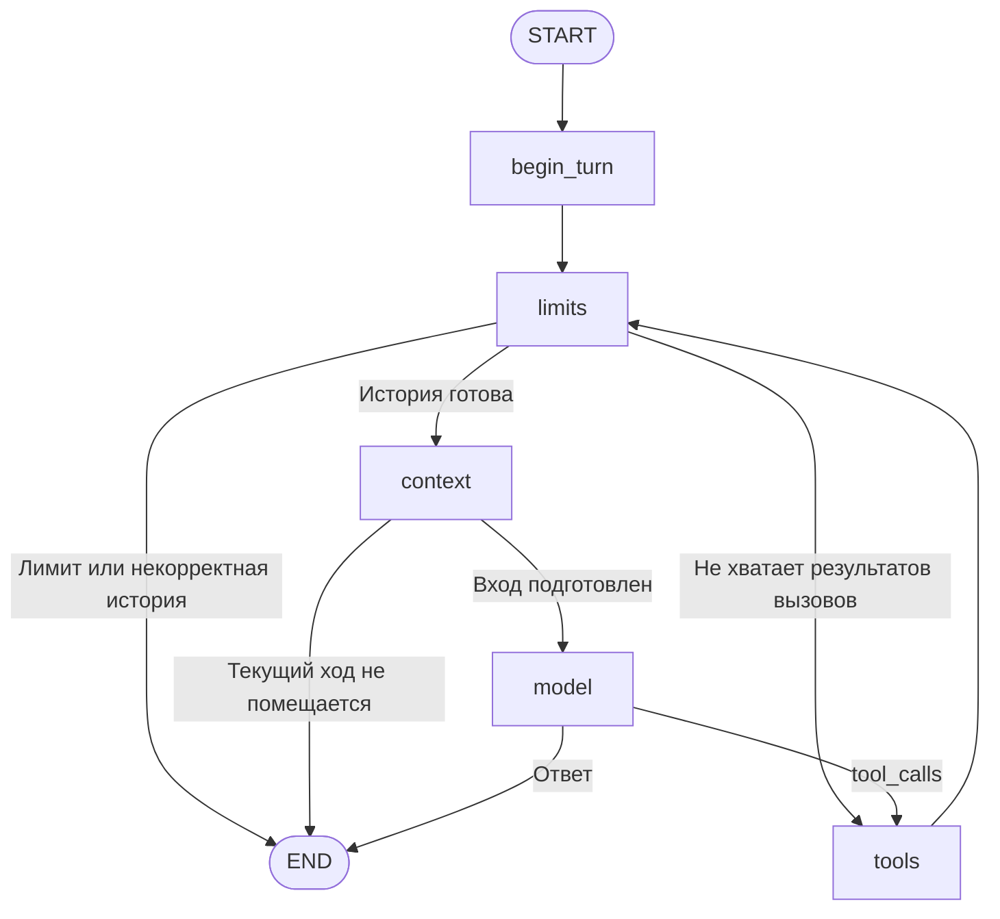

# Агентский пайплайн

LangGraph управляет собственным агентом, GLM-4 9B вызывается через Ollama.
История сохраняется в SQLite. Контракт инструментов общий с отдельным OpenCode;
его цикл исполнения в собственный граф не включается.

## Классы

| Файл | Ответственность |
|---|---|
| config.py | AgentConfig: модель, лимиты шагов, времени и токенов |
| graph.py, routing.py | Узлы, переходы и условия остановки |
| nodes.py | Операции графа и библиотечный ToolNode |
| history.py | Проверка соответствия вызовов и результатов |
| context.py | Подсчёт входа и применение сокращения |
| memory.py | MessageExcerpt и детерминированный MemoryCompressor |
| tokenizer.py | ChatTokenCounter на токенизаторе GLM |
| model.py, tool_response.py | Ollama и JSON Schema для вызова инструмента/ответа |
| dialogue.py | SqliteSaver и продолжение по thread_id |
| tools/ | Чтение Kubernetes, restart/scale/rollout и retrieval lab2 |

## Контекст без нейросетевой компрессии

До достижения 8192 токенов модель получает всю историю. При переполнении
MemoryCompressor формирует извлечения из старого префикса; LLM для этого не вызывается.
Последний пользовательский ход вместе с его вызовами и результатами остаётся целиком.

В task_memory сохраняются strategy=extractive-v2, data.records и covered_messages.
Каждая запись содержит source_id исходного сообщения, роль и извлечённый текст.
У результатов инструментов сохраняются также имя, аргументы и статус.
Ответы AI не переносятся в память как подтверждённые факты.

Приоритет включения: первая задача; остальные обычные пользовательские сообщения
от новых к старым; последние результаты инструментов; пользовательские сообщения
с крупными блоками данных. После отбора записи возвращаются в хронологическом порядке.
Это сохраняет исходную задачу и её уточнения перед большим объёмом архивных отчётов.

Крупные fenced-блоки заменяются явной отметкой пропуска; короткие блоки сохраняются.
Длинные извлечения ограничиваются 1600 символами с сохранением начала и конца.
Бюджет проверяется настоящим токенизатором для всего будущего входа, включая схемы
инструментов. Подсчёт повторяется при добавлении записей; непомещающиеся записи пропускаются.
Это ограниченное извлечение, не семантическое summary: сведения в пропусках могут быть потеряны.

Полные исходные сообщения остаются в SQLite. Новая память строится из них,
а не из предыдущего сокращённого текста, поэтому ошибка усечения не накапливается
при последовательных сжатиях. Память старой LLM-стратегии при продолжении сессии
перестраивается из исходной истории. Если текущий ход с обязательной задачей
не помещается даже после сокращения, возвращается context_limit.

Последнее пользовательское уточнение имеет приоритет над ранним. Извлечённые
наблюдения остаются историческими данными; текущее состояние читается инструментами.

## Лимиты и подсчёт

По умолчанию: 16 шагов, 600 секунд, вход 8192, окно модели 32768, выход 2048.
Таймаут графа проверяется между узлами; у сетевых вызовов есть собственные таймауты.
Сокращение истории больше не расходует генерации и не может завершиться ошибкой
нейросетевого summary или проверки сгенерированных цитат.

ChatTokenCounter загружает AutoTokenizer zai-org/glm-4-9b-chat-hf, ревизия
8599336fc6c125203efb2360bfaf4c80eef1d1bf, trust_remote_code=False.
Для glm4-agent используется prompts/chat_template.jinja. Размер входа — длина
результата apply_chat_template(tokenize=True, add_generation_prompt=True), включая инструменты.

## Инструменты и сохранение

KubernetesMCP использует готовый containers/kubernetes-mcp-server v0.1.2 по stdio
через MCPAdapter. ToolNode(handle_tool_errors=True) возвращает ошибки модели.
Разрешены чтения в agent-lab, restart Deployment и scale 1–5; изменение нод,
Secrets и произвольный shell недоступны. rollout_status возвращает один снимок;
ожидание организует агент. Потеря ответа не отменяет принятую операцию.

search_docs вызывает DocumentRetriever lab2 и возвращает фрагменты с источниками
и scores, без повторной генерации RAG-ответа. Индекс и эмбеддинги lab2 не меняются.

DialogueSession сохраняет полную messages и task_memory через SqliteSaver.
/new начинает новую сессию, --thread-id продолжает существующую.
Наблюдаемость подключается внешней обвязкой src/benchmark: CallbackHandler,
ObservedContext и ObservedMemory. В Langfuse context.memory содержит извлечённые
сообщения, context.compress — размеры до/после и результат сокращения.

## Проверки

[test_memory.py](../tests/test_memory.py) проверяет сохранение цели, уточнений
и результатов инструментов; [test_context.py](../tests/test_context.py) — бюджет
и целостность текущего хода. Поведение агентов в полном прогоне разобрано
в [analysis.md](../evaluation/analysis.md).
